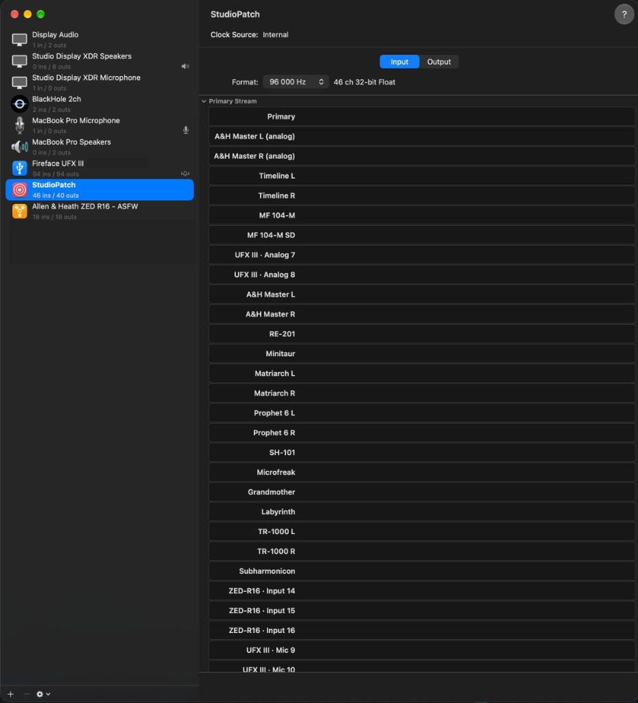

# User guide

This guide explains how to use the StudioPatch control panel. It assumes StudioPatch is already [built and installed](INSTALLATION.md).

## Concepts

- **StudioPatch** is one virtual audio device. Select it as both input and output device in your DAW.
- **To Computer** channels are the virtual device's *inputs*: audio from your interfaces going into the DAW.
- **From Computer** channels are the virtual device's *outputs*: audio from the DAW going out to your interfaces.
- The two directions are completely separate. Nothing played on From Computer is looped back to To Computer.
- The **control panel** (`StudioPatch.app`) only edits the configuration. A **background service** does the actual audio work and keeps running when you close the panel. The service starts at login, and opening the panel starts it if it is not running.

## The window

The **sidebar** on the left holds the virtual device settings and the list of audio interfaces. The **main area** shows the routing matrix (or channel list) for the selected direction, plus status and preset controls at the top.

### Virtual device

- **To Computer / From Computer:** how many channels the StudioPatch device exposes in each direction. Each can be 0–128, but at least one direction must be above zero for audio to run. Counts do not need to be powers of two; for example, 37 inputs and 21 outputs is fine.
- **Sync Source:** the interface whose clock drives the virtual device. Its latency is what StudioPatch reports to your DAW.
- **Sample Rate:** the rates the Sync Source supports. Changing it here, or changing the StudioPatch device's rate in your DAW, updates the Sync Source and all locked interfaces.
- **Advanced → I/O buffer:** the buffer size (32–1024 samples) StudioPatch uses when talking to the physical interfaces. This is separate from your DAW's buffer size. Smaller values give lower latency. The Advanced section also shows the current software margin and each secondary interface's latency difference relative to the Sync Source.

### Audio interfaces

Each physical interface has:

- A **Use** checkbox to make its channels available for routing.
- A **Sync** column. The Sync Source shows a clock icon. Every other selected interface shows a **lock**:
  - **Locked:** StudioPatch sets this interface to the Sync Source's sample rate.
  - **Unlocked:** StudioPatch never changes this interface's sample rate. If it does not match, audio stays muted until you fix the rate or lock the interface.
- **Drift correction** (secondary interfaces only). Leave it **off** when the interface is clocked from the Sync Source, for example over ADAT, word clock or MADI. Turn it **on** only for an interface that runs on its own clock; its routes then go through Apple's drift correction, which resamples them and adds some latency. StudioPatch cannot verify an external clock lock for you.

Clearing **Use** on an interface that has routes asks for confirmation. **Remove** deletes the interface and all its routes, including inactive ones; **Cancel** keeps everything.

## Routing

Use the **To Computer / From Computer** switch to pick a direction. Click a cell in the matrix to connect a source to a destination.

- **One source per destination.** Selecting a new source for a destination replaces the old connection. There is no mixing, summing, gain or other processing.
- **Unlimited fan-out.** One source can feed any number of destinations.
- Channel numbers start at **1**. Real channel names come from each interface's driver (for example Analog 9, ADAT 3, MADI 17).
- Row and column headers stay visible while you scroll. Hovering highlights the row and column under the pointer.
- **Channel list** shows the same routing as a list with a menu per destination, which can be easier for large setups.
- **Device order…** decides which interface's channels appear first in the matrix and list. This only affects the display and never interrupts audio.

Routing changes are applied automatically while audio is running, without interrupting other channels. Changing channel counts, the sample rate, the Sync Source, the I/O buffer or the set of interfaces restarts the audio engine, which causes a short interruption.

### Inactive routes

Channel counts and routing are stored separately. If you reduce a channel count, routes to the hidden channels become **inactive**: they are kept but carry no audio. A notice shows how many inactive routes exist. Increasing the count again reactivates them.

## Labels

**Labels…** lets you name hardware inputs and outputs, for example `Vocal mic` or `RE-201`.

- Labels appear on a separate line under the original channel name in the matrix and list, such as `UFX III · Analog 9 — Vocal mic`. Original names are never changed.
- Double-click a hardware channel header to jump straight to its label. Double-clicking a To Computer or From Computer header opens the label of the hardware channel it is connected to.
- To Computer and From Computer channels take their names from what they are connected to. These are the names your DAW shows for the StudioPatch device. An unconnected channel is called `To Computer N` or `From Computer N`. If one virtual channel feeds several outputs, their names are joined.
- Clear a label field to remove the label.



Channels with a label show it (for example `RE-201`); channels without one show the interface and hardware channel name (for example `ZED-R16 · Input 14`).

## Unplugged interfaces

If a selected interface disappears (unplugged, powered off), it stays in the list and matrix, greyed out, with its last known channels and labels.

- You can remove existing routes to and from it, but not add new ones.
- Audio is muted while a selected interface is missing, and the panel says which one.
- When the same interface returns, StudioPatch picks it up automatically and audio resumes.

## Presets and autosave

Every change is saved automatically and restored the next time you log in or open the panel. There is no Save step for everyday work.

Presets are named snapshots of the whole configuration:

- The name of the active preset is shown at the top. An asterisk (`*`) means the current configuration differs from it; **Save** updates the preset.
- **Presets…** lets you save the current configuration as a new preset, load, rename, overwrite or delete presets. Loading applies the preset immediately.

On first launch, nothing is routed, so opening StudioPatch never produces sound by itself.

## Status and notifications

The status line at the top shows whether routing is active, the current I/O buffer and sample rate, or why audio is muted. StudioPatch also sends macOS notifications when the audio format changes, when a change fails, or when audio is muted. Allow notifications for StudioPatch in System Settings if you want them.

**Secondary interface muted: clock alignment was lost.** StudioPatch detected that a secondary interface drifted away from the Sync Source and muted it to avoid out-of-sync audio. Check the digital clock connection, then restart the service:

```sh
launchctl kickstart -k gui/$(id -u)/se.studiopatch.runtime
```

**Automatic recovery stopped.** The service already restarted itself once in the last ten minutes. Fix the underlying device problem, then reopen the panel to start the service again.

## Interface-specific notes

- **RME (TotalMix):** StudioPatch outputs to an RME interface go to its *software playback* channels. TotalMix still decides which physical outputs they reach.
- **Mixers with USB/FireWire returns** (for example Allen & Heath ZED-R16): the mixer's own return settings decide where StudioPatch outputs end up.

## Using StudioPatch in a DAW

1. Select **StudioPatch** as the input and output device.
2. Pick the sample rate in the DAW or in the panel; the other follows.
3. Set the DAW buffer as usual. It is independent of StudioPatch's I/O buffer.
4. StudioPatch reports its latency to Core Audio, so DAW recording compensation works as with a normal interface. Keep any interface-specific correction you already use for the Sync Source.
