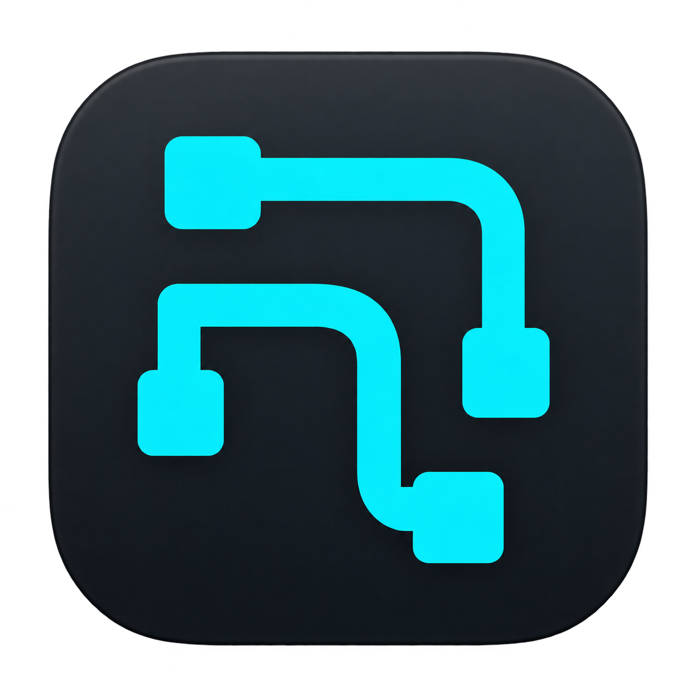
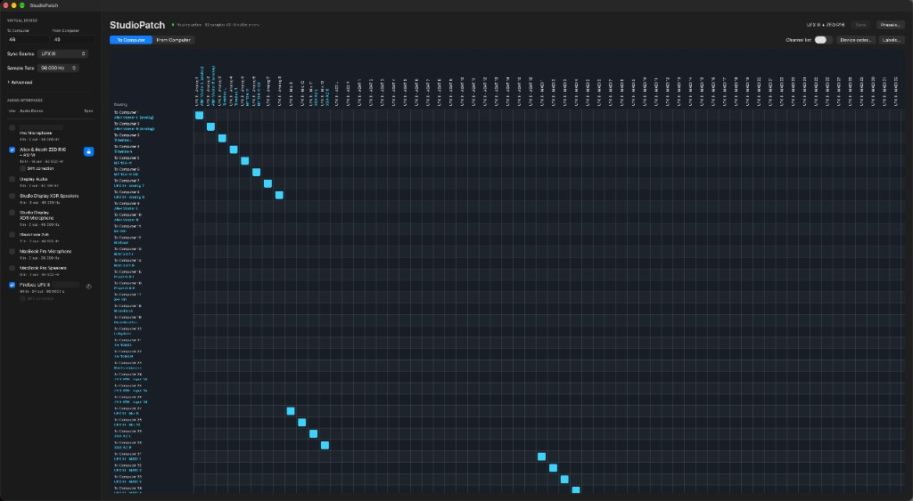

<p align="center">
  
</p>

<h1 align="center">StudioPatch</h1>

<p align="center">
  A virtual audio device and patchbay for macOS that combines channels from several audio interfaces into one device, in the order you choose.
</p>

---

> **Status: experimental (0.2.0).** StudioPatch installs a Core Audio driver and a privileged helper. It has been tested on one studio setup and has no prebuilt releases: you build and sign it yourself. Read [Docs/STATUS.md](Docs/STATUS.md) before relying on it.

## Why

If you record with more than one audio interface on a Mac, your DAW usually sees either one interface at a time or a macOS aggregate device that lists *every* channel of *every* interface in a fixed order. Neither gives you a short, named list of exactly the inputs and outputs you use.

StudioPatch gives your DAW a single device called **StudioPatch** with exactly the channels you choose. You decide in a routing matrix which hardware channel feeds which device channel, and the DAW shows your own names, such as "Vocal mic" or "RE-201", for them.



## Features

- **One virtual device, your channel layout.** 0–128 inputs and 0–128 outputs, chosen independently, filled from any channel of any connected interface.
- **Routing matrix** for each direction. One source per destination, unlimited fan-out, and no mixing, gain or other processing.
- **Your names in the DAW.** Label hardware channels once; the virtual channels are named after what they are connected to (see the screenshot below).
- **Low added latency.** The Sync Source interface is read directly through shared memory, without resampling. Measured: +0.67 ms round trip at 96 kHz and +1.33 ms at 48 kHz compared with using the interface directly ([details](Docs/LATENCY.md)).
- **Honest latency reporting**, so DAW recording compensation keeps working.
- **Sample rate follows your DAW.** Change the rate in the DAW or the panel; the Sync Source and locked interfaces follow.
- **Runs in the background.** Audio keeps running after you close the control panel and starts at login.
- **Survives unplugging.** A disconnected interface keeps its routes and labels (greyed out) and resumes when it comes back.
- **Autosave and presets.** Every change is saved immediately; named presets let you switch between setups.

<p align="center">
  
  <br>
  <em>The StudioPatch device in Audio MIDI Setup: every channel carries the label set in StudioPatch.</em>
</p>

## How it works

```text
Audio interfaces ◄──► StudioPatchService ◄── shared memory ──► StudioPatch driver ◄──► Your DAW
                      (background engine)                      (inside Core Audio)
                             ▲
                     StudioPatch.app (control panel: routing, labels, presets)
```

The control panel saves your configuration. A background service does the real-time audio work, and a Core Audio driver publishes the virtual device. A small root helper (the broker) connects the service and the driver to the same shared memory after checking their code signatures. Details are in [Docs/ARCHITECTURE.md](Docs/ARCHITECTURE.md).

## Requirements

- macOS 14 Sonoma or later (developed and tested on Apple Silicon)
- Xcode or the Command Line Tools, CMake 3.20+, Python 3
- An Apple code-signing certificate (a free Apple Development certificate works)
- Administrator rights to install the driver

## Quick start

```sh
git clone https://github.com/stephanterning/StudioPatch.git
cd StudioPatch

export STUDIOPATCH_SIGNING_IDENTITY="Apple Development: Your Name (TEAMID1234)"
bash Scripts/build.sh                       # build, run tests, sign into Dist/

sudo bash Scripts/install-transport.sh      # broker
sudo bash Scripts/install-driver.sh         # Core Audio driver
bash Scripts/install-service.sh             # background service (no sudo)
```

Restart the Mac, open `Dist/StudioPatch.app`, select your interfaces and a Sync Source, and choose **StudioPatch** as the audio device in your DAW.

Review the install scripts before running them with `sudo`, and keep the clone where it is: the background service runs from `Dist/`. Updating, uninstalling and troubleshooting are covered in [Docs/INSTALLATION.md](Docs/INSTALLATION.md).

Just want to look at the code or run the tests? You don't need a certificate. See [CONTRIBUTING.md](CONTRIBUTING.md).

## Documentation

- [Installation](Docs/INSTALLATION.md): build, sign, install, update, uninstall
- [User guide](Docs/USER-GUIDE.md): routing, labels, sync, presets
- [Architecture](Docs/ARCHITECTURE.md): components, signal path, source map
- [Latency](Docs/LATENCY.md): measurements and how to measure
- [Status and limitations](Docs/STATUS.md): what is verified and what is not
- [Contributing](CONTRIBUTING.md): tests, code rules, hardware testing

## License

StudioPatch is licensed under the [GNU Affero General Public License v3.0 only](LICENSE).

It includes [libASPL](https://github.com/gavv/libASPL) by Victor Gaydov and contributors (MIT License, with Apple sample-code licenses), vendored with local changes in `Vendor/libASPL/`.

StudioPatch is an independent project and is not affiliated with Apple, RME or Allen & Heath.
